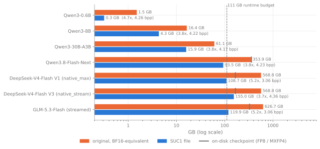
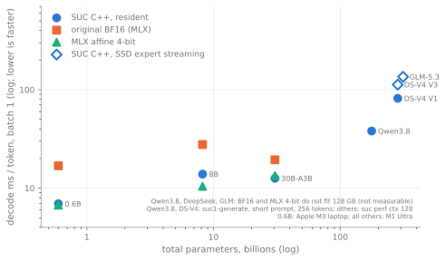
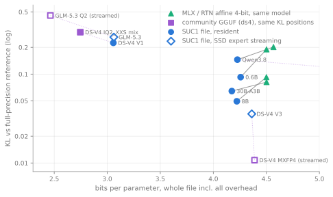
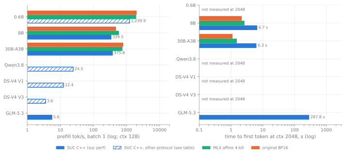

# SUC compression report — Qwen3-0.6B to GLM-5.3-Flash

Italiano: [compression_report-IT.md](compression_report-IT.md)

Every compressed model of the project against its **original full-precision model** and against other runtimes:
size, memory, speed (TTFT, prefill, decode) and quality. Every number comes from a result JSON in
`experiments/results/` (cited as `R:<file>`). "—" = not measured. Status: 14 October 2026.

**Conventions.** *Original size* = BF16-equivalent bytes of every checkpoint tensor (the model PPL and KL are measured
against; for DeepSeek / GLM, published in FP8 / MXFP4, the exact dequantization). *bpp* = file bits / all parameters,
every overhead included. *Memory* = mapped file + process footprint of the C++ runtime. *Speed* = batch 1, C++
`suc1-generate`, greedy, 256 tokens, single run (§1b–§1c). *Quality* = KL / top-1 vs the reference logits on 16 × 512
held-out validation positions and WikiText-2 test PPL (all windows), from the `suc compress` evaluate stage. Machine:
Mac Studio M1 Ultra 128 GB (111 GB budget for the model), except Qwen3-0.6B (Apple M3, 16 GB).

## 1. Summary

### Size and quality

The chosen SUC1 file per model. Original = BF16-equivalent size of the full-precision model that quality is measured
against. KL / top-1 = next-token divergence / agreement vs the original on 16 × 512 held-out positions; PPL =
WikiText-2 test.

| Model | Type | Params | Original GB | SUC1 GB | bpp | Smaller by | Memory at run time GB | KL | top-1 | PPL original → SUC |
|---|---|---:|---:|---:|---:|---:|---:|---:|---:|---|
| Qwen3-0.6B | dense | 0.6 B | 1.50 | 0.32 | 4.26 | 4.7× | 0.42 | 0.092 | 0.853 | 20.97 → 22.83 |
| Qwen3-8B | dense | 8.2 B | 16.38 | 4.32 | 4.22 | 3.8× | 4.63 | 0.049 | 0.902 | 9.72 → 9.99 |
| Qwen3.8-27B (side8) | dense | 26.9 B | 53.79 | 16.36 | 4.87 | 3.3× | 16.75 | 0.023 | 0.950 | 7.05 → 7.15 |
| Qwen3-30B-A3B | MoE | 30.5 B | 61.06 | 15.93 | 4.17 | 3.8× | 17.11 | 0.064 | 0.897 | 8.70 → 9.14 |
| Qwen3.8-Flash-Next (side8) | MoE | 176.9 B | 353.89 | 96.32 | 4.35 | 3.7× | 73.82 ¹ | 0.064 | 0.913 | 4.70 → 4.70 |
| DeepSeek-V4-Flash (tcq) | MoE | 284.3 B | 568.75 ² | 96.82 | 2.72 | 5.9× | 102.57 | 0.235 | 0.825 | 4.78 → 5.59 |
| GLM-5.3-Flash (tcq) | MoE | 313.3 B | 626.65 ² | 99.00 | 2.53 | 6.3× | 106.59 | 0.307 | 0.793 | 3.27 → 4.27 |

bpp = file bits / all parameters, every overhead included (codebooks, scales, residuals, embedding, head, metadata).
¹ The 4-bit n-gram tables (26.9 GB) are read from the file row by row, not kept in GPU memory. ² DeepSeek and GLM are
published already low-precision (FP8 + MXFP4: 166.88 GB; FP8: 328.33 GB); against those files SUC1 is 1.7× and
3.3× smaller. All files run fully in memory; the higher-quality DeepSeek file that streams experts from SSD is in
the third table and §4.

### Speed of the SUC C++ runtime

`suc1-generate`, greedy, 256 generated tokens. *Short* = a 12–13-token prompt; *2k / 32k* = the first 2,048 / 32,768
tokens of the same long text. TTFT = prompt processing + first token.

| Model | Decode tok/s (short prompt) | Prefill tok/s · TTFT, short | Prefill tok/s · TTFT, 2k | Prefill tok/s, 8k | Prefill tok/s · TTFT, 32k | Decode tok/s at 32k |
|---|---:|---:|---:|---:|---:|---:|
| Qwen3-0.6B (M3) | 143.9 | — | — | — | — | — |
| Qwen3-8B | 76.3 | 128 · 0.11 s | 304 · 6.8 s | 231 | 106 · 309 s | 42.5 |
| Qwen3.8-27B (side8) | 25.3 | 43 · 0.35 s | 93 · 22.1 s | 85 | 58 · 564 s | 20.4 |
| Qwen3-30B-A3B | 82.4 | 199 · 0.08 s | 367 · 5.6 s | 244 | 101 · 324 s | 37.5 |
| Qwen3.8-Flash-Next (side8) | 28.3 | 55 · 0.27 s | 341 · 6.0 s | 323 | 323 · 102 s | 29.2 |
| DeepSeek-V4-Flash (tcq) | 24.0 | 46 · 0.30 s | 171 · 12.0 s | 163 | 138 · 238 s | 13.7 |
| GLM-5.3-Flash (tcq) | 22.2 | 35 · 0.41 s | 116 · 17.7 s | 105 | 94 · 349 s | 13.1 |

The batched prompt prefill is not bit-identical to token-by-token prefill (KL 0.0006–0.03 between the two,
§1c). Decode is bit-identical to the Python runtime.

### Against other runtimes and formats

Same machine. KL on the same positions and reference as table 1. Decode and short-prompt prefill on the same prompt.
*Long prefill*: SUC at 32k tokens on the shared long text; ds4 / llama.cpp / LM Studio = median over the hard-suite
prompts of 4k–31k tokens (a different prompt set: indicative). *Hard suite*: 120 graded questions (math, knowledge,
reasoning, long context), same prompts for every system.

| Model | System | File GB | KL | Decode tok/s | Prefill tok/s · TTFT, short | Prefill tok/s · TTFT, 2k | Long prefill tok/s | Hard suite /120 |
|---|---|---:|---:|---:|---:|---:|---:|---:|
| Qwen3-0.6B | **SUC1** (M3) | 0.32 | 0.092 | 143.9 | — | — | — | — |
| | GGUF Q4_K_M, LM Studio | 0.48 | 0.097 | 219.8 | 594 · 0.02 s | 7,785 · 0.26 s | — | — |
| | GGUF Q8_0, LM Studio | 0.80 | 0.002 | 197.3 | 615 · 0.02 s | 8,151 · 0.25 s | — | — |
| Qwen3-8B | **SUC1** | 4.32 | 0.049 | 76.3 | 128 · 0.11 s | 304 · 6.8 s | 106 | — |
| | GGUF Q4_K_M, LM Studio | 5.03 | 0.040 | 74.8 | 176 · 0.07 s | 884 · 2.3 s | — | — |
| | GGUF Q8_0, LM Studio | 8.71 | 0.001 | 67.9 | 193 · 0.07 s | 1,007 · 2.0 s | — | — |
| | MLX 4-bit, mlx-lm ³ | 4.61 | 0.092 | 95.8 | 588 (128 tok) | — · 2.7 s | — | — |
| Qwen3.8-27B | **SUC1 side8** | 16.36 | 0.023 | 25.3 | 43 · 0.35 s | 93 · 22.1 s | 58 | 93 |
| | GGUF Q8_0, llama.cpp | 29.05 | — | 20.8 ⁴ | — | — | 252 | 92 |
| | MLX 8-bit, LM Studio | ≈ 28.6 | 0.002 | 19.4 ⁴ | — | — | 213 | 89 |
| | MLX 4-bit, mlx-lm ³ | ≈ 15.2 | 0.045 | 26.0 | 169 (128 tok) | 214 · 9.6 s | — | — |
| Qwen3-30B-A3B | **SUC1** | 15.93 | 0.064 | 82.4 | 199 · 0.08 s | 367 · 5.6 s | 101 | — |
| | GGUF Q4_K_M, LM Studio | 18.56 | 0.039 | 93.6 | 192 · 0.07 s | 1,455 · 1.4 s | — | — |
| | GGUF Q8_0, LM Studio | 32.48 | 0.006 | 79.9 | 146 · 0.09 s | 1,642 · 1.2 s | — | — |
| | MLX 4-bit, mlx-lm ³ | 17.2 | 0.081 | 74.8 | 753 (128 tok) | — · 1.5 s | — | — |
| Qwen3.8-Flash-Next | **SUC1 side8** | 96.32 | 0.064 | 28.3 | 55 · 0.27 s | 341 · 6.0 s | 323 | 97 |
| | GGUF Q4, ds4 ⁵ | 177.28 | 0.061 | 33.6 | 47 · 0.31 s | — | 558 | 99 |
| DeepSeek-V4-Flash | **SUC1 tcq** | 96.82 | 0.235 | 24.0 | 46 · 0.30 s | 171 · 12.0 s | 138 | 103 |
| | GGUF IQ2_XXS mix, ds4 | 97.59 | 0.296 | 24.5 | 42 · 0.33 s | — | 224 | 106 |
| | SUC1 V3, experts from SSD ⁶ | 155.05 | 0.036 | 13.1 | 43 · 0.36 s | 28 · 74 s | — | — |
| | GGUF MXFP4, ds4, experts from SSD | 155.98 | 0.011 | 10.0 | 7 · 1.97 s | — | — | — |
| GLM-5.3-Flash | **SUC1 tcq** | 99.00 | 0.307 | 22.2 | 35 · 0.41 s | 116 · 17.7 s | 94 | 99 |
| | GGUF Q2, ds4, experts from SSD | 96.51 | 0.456 | 24.3 | 41 · 0.36 s | — | 117 | 93 |

³ Historical `suc perf` session (October 2–8): decode at a 128-token context, prefill at 128 tokens, TTFT at 2,048.
⁴ Hard-suite median. ⁵ The GGUF keeps a 102.4-GB BF16 n-gram table on disk; its weights in memory are 74.8 GB (SUC1:
73.8 GB). ⁶ Every routed expert kept in its native MXFP4 format: the quality ceiling. ds4 rows: ds4 engine commit
`9139e2a`, runs of October 6–7 (long prefill and hard suite: October 11); LM Studio: llama.cpp runtime 2.41.0, GGUFs quantized locally without imatrix.

**Findings.**

1. **Size.** 3.3–4.7× smaller than the original at 4.2–4.9 bpp (Qwen family), 5.9–6.3× at 2.5–2.7 bpp (DeepSeek, GLM;
   1.7× / 3.3× against their published FP8 / MXFP4 files). Every chosen file runs fully in memory within 111 GB.
2. **Quality per bit.** SUC beats MLX / RTN 4-bit KL with fewer bits wherever that baseline could run (0.6B 0.092 vs
   0.190, 8B 0.049 vs 0.092, 30B-A3B 0.064 vs 0.081, Qwen3.8-Flash 0.064 vs 0.202); on 27B side8 halves the KL at
   +0.36 bpp (0.023 at 4.87 vs 0.045 at 4.51) and the 4.22-bpp base file also beats it (0.031). GGUF Q4_K_M has lower
   KL than SUC on 8B and 30B-A3B at ≈ 0.7 bpp more (not on 0.6B; §6); at 2.5–2.7 bpp SUC tcq beats the community 2-bit GGUFs of the same size (§5).
3. **Decode** within 12 % of the fastest GGUF runtime except Qwen3.8-Flash (−16 % vs ds4); 1.5–2.5× faster than the
   original BF16 where it fits (§2).
4. **Prefill / TTFT** is the gap: 1.2–1.7× slower than ds4 and 3–4.5× slower than llama.cpp / LM Studio on
   long prompts; TTFT 5.6–6.8 s at 2k on the Qwen3
   models vs 1.2–2.3 s for LM Studio. The batched prefill is not bit-identical to token prefill (KL 0.0006–0.03, §1c).
5. **Answers.** 120-case hard suite: SUC vs the best competitor −3 to +6 questions, no significant paired difference
   (§7). The 30-case core suite saturates (29–30/30 for every file of 8B and larger).

Sources. Quality: R:`20261002T202145Z_compress_qwen3_0.6b_final`, R:`20261002T191301Z_compress_qwen3_8b_final`,
R:`20261007T230047Z_compress_qwen3.8_27b_side8`, R:`20261002T212215Z_compress_qwen3_30b_a3b_final`,
R:`20261007T140252Z_compress_qwen3.8_flash_next_side8`, R:`20261009T181636Z_compress_deepseek_v4_flash_tcq`,
R:`20261010T124951Z_compress_glm5.3_flash_tcq`. Speed: the §1b / §1c rows; Qwen3-0.6B
R:`20261002T205833Z_cpp_check_qwen3_0.6b_final_m3`. Competitors: §5 (ds4), §6 (LM Studio), §2 (MLX); long-prompt
competitor rates and hard-suite counts: R:`20261011T011939Z_gguf_eval_hard20_ds_iq2`,
R:`20261011T075042Z_gguf_eval_hard20_glm_q2`, R:`20261011T132617Z_gguf_eval_hard20_q38_q4`,
R:`20261011T213929Z_gguf_eval_hard20_llamacpp_q38_27b_q8_0`, R:`20261012T025455Z_gguf_eval_hard20_lms_q38_27b_8bit`
and the SUC files of §7 (median prefill over prompts ≥ 4k tokens; decode = (tokens − 1) / (time − prefill) median).

<!-- cpp-decode-current:begin (generated by scripts/cpp_speed_rows.py; do not edit by hand) -->
### 1b. C++ decode, current build

`scripts/frontier_measure.py generate`: `suc1-generate` with its defaults at the commit shown, batch 1, greedy,
the frontier prompt (prefill column: its tokens; GLM with a trailing comma), 256 tokens, single run, decode =
median of steps 2…256; streamed rows with the
`--expert-budget` / `--hot-experts auto` of their earlier records. The §1 decode column is taken from these rows
(Qwen3.8-27B: the §1c short row).

| Model | decode ms/tok | tok/s | GPU ms/tok | prefill s | expert hit rate | previous record ms/tok | Δ | result (commit) |
|---|---|---|---|---|---|---|---|---|
| Qwen3-8B (final) | 13.10 | 76.3 | 13.04 | 0.10 (12 tok) | — | 12.70 (R:`20261010T230512Z_gen_cpp_qwen3_8b_final`) | +3.1 % | R:`20261012T054020Z_gen_cpp_qwen3_8b_final` (258b03f) |
| Qwen3-30B-A3B (final, uniform) | 12.13 | 82.4 | 12.09 | 0.06 (12 tok) | — | 11.87 (R:`20261010T231250Z_gen_cpp_qwen3_30b_a3b_final`) | +2.2 % | R:`20261012T055423Z_gen_cpp_qwen3_30b_a3b_final` (f04d199) |
| Qwen3.8-Flash-Next side8 (ngram4) | 35.30 | 28.3 | 26.48 | 0.23 (12 tok) | — | 34.40 (R:`20261010T232151Z_gen_cpp_qwen3.8_flash_next_side8_ngram4`) | +2.6 % | R:`20261012T050109Z_gen_cpp_qwen3.8_flash_next_side8_ngram4` (db83734) |
| Qwen3.8-Flash-Next iso (ngram4) | 35.31 | 28.3 | 26.64 | 0.17 (12 tok) | — | 35.18 (R:`20261007T154126Z_gen_cpp_qwen3.8_flash_next_iso_ngram4`) | +0.3 % | R:`20261008T165246Z_gen_cpp_qwen3.8_flash_next_iso_ngram4` (1a2dc24) |
| DeepSeek-V4-Flash V1 (native_max, in memory) | 39.19 | 25.5 | 36.97 | 0.27 (11 tok) | — | 39.05 (R:`20261007T154239Z_gen_cpp_deepseek_v4_flash_native_max`) | +0.4 % | R:`20261008T165717Z_gen_cpp_deepseek_v4_flash_native_max` (1a2dc24) |
| DeepSeek-V4-Flash V3 (native_stream, SSD experts) | 76.09 | 13.1 | 35.15 | 0.25 (11 tok) | 0.955 | 78.92 (R:`20261007T154331Z_gen_cpp_deepseek_v4_flash_native_stream`) | -3.6 % | R:`20261008T171204Z_gen_cpp_deepseek_v4_flash_native_stream` (b6fb206) |
| GLM-5.3-Flash (SSD experts) | 109.59 | 9.1 | 45.36 | 2.12 (13 tok) | 0.911 | 112.97 (R:`20261007T154440Z_gen_cpp_glm5.3_flash_streamed`) | -3.0 % | R:`20261008T180714Z_gen_cpp_glm5.3_flash_streamed` (09f58b8) |
| DeepSeek-V4-Flash tcq (in memory) | 41.61 | 24.0 | 38.60 | 0.25 (11 tok) | — | 41.59 (R:`20261012T033424Z_gen_cpp_deepseek_v4_flash_tcq`) | +0.1 % | R:`20261012T040303Z_gen_cpp_deepseek_v4_flash_tcq` (a7d2b0f) |
| GLM-5.3-Flash tcq (in memory) | 45.08 | 22.2 | 41.62 | 0.35 (12 tok) | — | 44.82 (R:`20261011T001020Z_gen_cpp_glm5.3_flash_tcq`) | +0.6 % | R:`20261012T043057Z_gen_cpp_glm5.3_flash_tcq` (f6c001c) |
| DeepSeek-V4-Flash tcq, calib mix v2 (in memory) | 41.77 | 23.9 | 38.76 | 0.25 (11 tok) | — | — | — | R:`20261012T233316Z_gen_cpp_deepseek_v4_flash_tcq_mathcal` (efce37c) |
<!-- cpp-decode-current:end -->

<!-- cpp-prefill-current:begin (generated by scripts/cpp_speed_rows.py; do not edit by hand) -->
### 1c. C++ prefill and TTFT, current build (batched prefill)

`scripts/studio_prefill_measure.sh` (`scripts/frontier_measure.py generate`), batch 1, greedy, 256 tokens,
single run, Mac Studio M1 Ultra, each run after `scripts/studio_wait_idle.sh`. Prompts shared with the LM Studio
/ llama.cpp runs (`suc.evaluation.speed_prompts`): short = the frontier sentence (raw text), long = the first
2,048 ids of the raw tokenization of `experiments/perf/promessi_sposi_head.txt` with the model's own tokenizer.
Prefill tok/s = prompt tokens / prefill wall time (pipeline compiles excluded); TTFT = prefill + one decode
step; decode = median of steps 2…256 after that prompt. Batched prefill (default, layer by layer over chunks;
cpp/README.md): Qwen3 / Qwen3-MoE graph chunks of 64 tokens, projections at batch n (simdgroup-matrix lookup).
qwen4_exp / qwen3_5 / deepseek_v4 / glm5_next (since 2026-10-10, owner decision: small rounding differences
allowed, measured): simdgroup-matrix GEMMs over the chunk rows (SUC "mma" lookup, affine / dense / tcq GEMM
kernels), routed experts in 8-16-row MMA tiles, DeepSeek's compressors and attention batched over the chunk;
since 2026-10-11 (docs/prefill_vs_ds4.md) also DeepSeek's lightning indexer past 2,048 tokens, Qwen3.8's QSA
attention and every row-local launch batched over the chunk, GLM's DSA over the selected pools only;
chunks of 4,096 (DeepSeek, GLM; 1,024 beyond 8,192-token prompts) / 1,024 (qwen4_exp, qwen3_5) tokens, at most
the prompt (1,024 / 512 before 2026-10-12). Rows of an older commit were measured with
the earlier row-exact batched prefill (now `--prefill exact`). Token prefill = `--prefill token` (decode steps);
bit-identical = the last prompt token's logits (and, where recorded, streams) sha256 agree between the two; the
size of the difference is in the second table.

| Model | short: prompt tok | prefill tok/s | TTFT s | decode ms/tok | 2k: prompt tok | prefill tok/s | TTFT s | decode ms/tok | 2k token-prefill tok/s | batched speed-up | bit-identical | results (commit) |
|---|---|---|---|---|---|---|---|---|---|---|---|---|
| Qwen3-8B (final) | 13 | 128.4 | 0.11 | 13.04 | 2048 | 304.2 | 6.75 | 13.72 | 75.9 | 4.0x | **no** | R:`20261012T054125Z_gen_cpp_qwen3_8b_final_short`, R:`20261012T054237Z_gen_cpp_qwen3_8b_final_long2k`, R:`20261010T230902Z_gen_cpp_qwen3_8b_final_long2k_token` (258b03f) |
| Qwen3-30B-A3B (final, uniform) | 13 | 198.5 | 0.08 | 12.20 | 2048 | 367.4 | 5.59 | 13.81 | 66.9 | 5.5x | **no** | R:`20261012T055530Z_gen_cpp_qwen3_30b_a3b_final_short`, R:`20261012T055643Z_gen_cpp_qwen3_30b_a3b_final_long2k`, R:`20261010T231657Z_gen_cpp_qwen3_30b_a3b_final_long2k_token` (f04d199) |
| Qwen3.8-Flash-Next side8 (ngram4) | 13 | 54.7 | 0.27 | 31.37 | 2048 | 341.2 | 6.04 | 33.82 | 39.9 | 8.6x | **no** | R:`20261012T050239Z_gen_cpp_qwen3.8_flash_next_side8_ngram4_short`, R:`20261012T050422Z_gen_cpp_qwen3.8_flash_next_side8_ngram4_long2k`, R:`20261010T232756Z_gen_cpp_qwen3.8_flash_next_side8_ngram4_long2k_token` (db83734) |
| DeepSeek-V4-Flash V1 (native_max, in memory) | 12 | 41.4 | 0.33 | 38.66 | 2048 | 40.6 | 50.44 | 43.87 | 27.0 | 1.5x | yes | R:`20261008T170035Z_gen_cpp_deepseek_v4_flash_native_max_short`, R:`20261008T170437Z_gen_cpp_deepseek_v4_flash_native_max_long2k`, R:`20261008T170912Z_gen_cpp_deepseek_v4_flash_native_max_long2k_token` (1a2dc24) |
| DeepSeek-V4-Flash V3 (native_stream, SSD experts) | 12 | 42.9 | 0.36 | 77.10 | 2048 | 27.7 | 73.93 | 70.65 | 14.2 | 1.9x | yes | R:`20261008T171451Z_gen_cpp_deepseek_v4_flash_native_stream_short`, R:`20261008T173852Z_gen_cpp_deepseek_v4_flash_native_stream_long2k`, R:`20261008T180400Z_gen_cpp_deepseek_v4_flash_native_stream_long2k_token` (db47247) |
| GLM-5.3-Flash (SSD experts) | 13 | 6.6 | 2.08 | 117.34 | 2048 | 16.3 | 125.84 | 97.53 | 10.2 | 1.6x | yes | R:`20261009T055050Z_gen_cpp_glm5.3_flash_streamed_short`, R:`20261009T074955Z_gen_cpp_glm5.3_flash_streamed_long2k`, R:`20261009T075605Z_gen_cpp_glm5.3_flash_streamed_long2k_token` (28b3ddf) |
| DeepSeek-V4-Flash tcq (in memory) | 12 | 45.7 | 0.30 | 41.99 | 2048 | 171.4 | 11.99 | 46.74 | 25.7 | 6.7x | **no** | R:`20261012T040518Z_gen_cpp_deepseek_v4_flash_tcq_short`, R:`20261012T040803Z_gen_cpp_deepseek_v4_flash_tcq_long2k`, R:`20261010T235732Z_gen_cpp_deepseek_v4_flash_tcq_long2k_token` (a7d2b0f) |
| GLM-5.3-Flash tcq (in memory) | 13 | 35.2 | 0.41 | 45.20 | 2048 | 116.3 | 17.66 | 49.50 | 22.4 | 5.2x | **no** | R:`20261012T043319Z_gen_cpp_glm5.3_flash_tcq_short`, R:`20261012T043619Z_gen_cpp_glm5.3_flash_tcq_long2k`, R:`20261011T001942Z_gen_cpp_glm5.3_flash_tcq_long2k_token` (f6c001c) |
| DeepSeek-V4-Flash tcq, calib mix v2 (in memory) | 12 | 46.1 | 0.30 | 41.78 | 2048 | 170.3 | 12.07 | 46.68 | — | — | — | R:`20261012T233528Z_gen_cpp_deepseek_v4_flash_tcq_mathcal_short`, R:`20261012T233815Z_gen_cpp_deepseek_v4_flash_tcq_mathcal_long2k` (efce37c) |
| Qwen3.8-27B side8 (dense) | 13 | 42.6 | 0.35 | 39.53 | 2048 | 93.0 | 22.05 | 40.55 | 28.4 | 3.3x | **no** | R:`20261012T051802Z_gen_cpp_qwen3.8_27b_side8_short`, R:`20261012T051950Z_gen_cpp_qwen3.8_27b_side8_long2k`, R:`20261010T234016Z_gen_cpp_qwen3.8_27b_side8_long2k_token` (f63b320) |
| Qwen3.8-27B base (dense) | 13 | 65.6 | 0.24 | 39.12 | 2048 | 68.4 | 29.98 | 40.32 | 28.9 | 2.4x | yes | R:`20261009T182408Z_gen_cpp_qwen3.8_27b_base_short`, R:`20261009T195901Z_gen_cpp_qwen3.8_27b_base_long2k`, R:`20261009T200225Z_gen_cpp_qwen3.8_27b_base_long2k_token` (149c389) |

Long prompts (`scripts/studio_prefill_final.sh`): the first 2,048 / 8,192 / 32,768 ids of the same long
prompt, default batched prefill, 256 greedy tokens after it; prefill tok/s · TTFT s · decode ms/tok
(decode at that context). Attribution of the prefill time and the comparison with ds4: docs/prefill_vs_ds4.md.

| Model | 2k prefill tok/s | 2k TTFT s | 2k decode ms/tok | 8k prefill tok/s | 8k TTFT s | 8k decode ms/tok | 32k prefill tok/s | 32k TTFT s | 32k decode ms/tok | results (commit) |
|---|---|---|---|---|---|---|---|---|---|---|
| Qwen3-8B (final) | 304.2 | 6.75 | 13.72 | 231.3 | 35.43 | 16.16 | 106.1 | 308.94 | 23.51 | R:`20261012T054418Z_gen_cpp_qwen3_8b_final_long8k`, R:`20261012T055035Z_gen_cpp_qwen3_8b_final_long32k` (258b03f) |
| Qwen3-30B-A3B (final, uniform) | 367.4 | 5.59 | 13.81 | 243.5 | 33.67 | 18.72 | 101.0 | 324.36 | 26.68 | R:`20261012T055826Z_gen_cpp_qwen3_30b_a3b_final_long8k`, R:`20261012T060501Z_gen_cpp_qwen3_30b_a3b_final_long32k` (f04d199) |
| Qwen3.8-Flash-Next side8 (ngram4) | 341.2 | 6.04 | 33.82 | 323.4 | 25.37 | 33.04 | 322.9 | 101.52 | 34.20 | R:`20261012T050627Z_gen_cpp_qwen3.8_flash_next_side8_ngram4_long8k`, R:`20261012T050949Z_gen_cpp_qwen3.8_flash_next_side8_ngram4_long32k` (db83734) |
| DeepSeek-V4-Flash tcq (in memory) | 171.4 | 11.99 | 46.74 | 163.2 | 50.26 | 54.26 | 137.8 | 237.90 | 73.12 | R:`20261012T041139Z_gen_cpp_deepseek_v4_flash_tcq_long8k`, R:`20261012T041806Z_gen_cpp_deepseek_v4_flash_tcq_long32k` (a7d2b0f) |
| GLM-5.3-Flash tcq (in memory) | 116.3 | 17.66 | 49.50 | 105.1 | 78.02 | 55.12 | 93.8 | 349.47 | 76.12 | R:`20261012T044027Z_gen_cpp_glm5.3_flash_tcq_long8k`, R:`20261012T044853Z_gen_cpp_glm5.3_flash_tcq_long32k` (f6c001c) |
| DeepSeek-V4-Flash tcq, calib mix v2 (in memory) | 170.3 | 12.07 | 46.68 | 161.3 | 50.86 | 54.40 | 137.2 | 238.88 | 72.94 | R:`20261012T234153Z_gen_cpp_deepseek_v4_flash_tcq_mathcal_long8k`, R:`20261012T234820Z_gen_cpp_deepseek_v4_flash_tcq_mathcal_long32k` (efce37c) |
| Qwen3.8-27B side8 (dense) | 93.0 | 22.05 | 40.55 | 84.8 | 96.59 | 42.49 | 58.1 | 563.82 | 49.03 | R:`20261012T052251Z_gen_cpp_qwen3.8_27b_side8_long8k`, R:`20261012T053341Z_gen_cpp_qwen3.8_27b_side8_long32k` (d71f978) |

Batched vs token prefill (`scripts/prefill_batch_vs_token.py`, the 2,048-token prompt): logits
of every prompt position and of 32 continuation steps teacher-forced on the token run's greedy tokens (batched
run with `--logits-out`, i.e. every row through the LM head), KL(token ‖ batched) mean / max and top-1
agreement (mismatches); the last prompt token as the production runs compute it; the first step at which the
free-running greedy continuations (256 tokens) differ. Sources of the difference (cpp/README.md): Qwen3 graph:
the simdgroup-matrix lookup of the batch tiles, the structured residual's reduction split for multi-row tiles
and the single-pass attention of the batch rows; frontier graphs: the GEMM accumulation order of every
projection and expert tile (float32, one rounding), DeepSeek's chunk attention matches the decode step's
roundings.

| Model | prompt tok | prompt KL mean / max | prompt top-1 | continuation KL mean / max | continuation top-1 | last-token KL | last-token top-1 | greedy first divergence (tokens) | result |
|---|---|---|---|---|---|---|---|---|---|
| Qwen3-8B (final) | 2048 | 9.88e-04 / 1.75e-02 | 0.9844 (32) | 7.68e-04 / 3.10e-03 | 0.9677 (1) | 9.94e-04 | 1 | 8 (256) | R:`20261012T055307Z_prefill_batch_vs_token_qwen3_8b_final` |
| Qwen3-30B-A3B (final, uniform) | 2048 | 3.08e-03 / 7.44e-02 | 0.9712 (59) | 3.46e-03 / 1.04e-02 | 0.9355 (2) | 1.56e-03 | 1 | 17 (256) | R:`20261012T060743Z_prefill_batch_vs_token_qwen3_30b_a3b_final` |
| Qwen3.8-Flash-Next side8 (ngram4) | 2048 | 3.08e-02 / 1.20e+00 | 0.9150 (174) | 3.87e-02 / 2.03e-01 | 0.8065 (6) | 3.84e-02 | 0 | 0 (256) | R:`20261012T051524Z_prefill_batch_vs_token_qwen3.8_flash_next_side8_ngram4` |
| DeepSeek-V4-Flash tcq (in memory) | 2048 | 2.58e-02 / 1.17e+00 | 0.9438 (115) | 1.83e-02 / 1.40e-01 | 0.9355 (2) | 5.81e-04 | 1 | 22 (256) | R:`20261012T042732Z_prefill_batch_vs_token_deepseek_v4_flash_tcq` |
| GLM-5.3-Flash tcq (in memory) | 2048 | 1.16e-02 / 4.06e-01 | 0.9380 (127) | 7.12e-03 / 5.90e-02 | 0.9355 (2) | 4.19e-03 | 1 | 4 (256) | R:`20261012T045908Z_prefill_batch_vs_token_glm5.3_flash_tcq` |
| Qwen3.8-27B side8 (dense) | 2048 | 6.25e-04 / 8.50e-03 | 0.9863 (28) | 6.15e-04 / 4.54e-03 | 1.0000 (0) | 3.63e-04 | 1 | 52 (256) | R:`20261012T053911Z_prefill_batch_vs_token_qwen3.8_27b_side8` |
<!-- cpp-prefill-current:end -->

History of the prefill work and the profiles behind it: [cpp/README.md](../cpp/README.md) ("Fast batched prefill") and
[prefill_vs_ds4.md](prefill_vs_ds4.md).

## 2. The original models' own speed

Matched `suc perf` sessions of 2026-10-02/08 (BF16, MLX affine 4-bit and SUC in one session per model; decode at ctx
128, median of 3). The ratio columns compare with SUC's decode *in that session*; SUC prefill has been rewritten
since (§1c), so only the BF16 / MLX columns are references here.

| Model | Original BF16: decode ms/tok · prefill tok/s · TTFT 128 / 2048 s · memory | MLX affine 4-bit: same columns · PPL / KL | SUC C++ vs original BF16 (decode) | SUC C++ vs MLX 4-bit (decode) |
|---|---|---|---|---|
| Qwen3-0.6B (M3) ᵃ | 16.88 · 2,031 · 0.063 / — · 1.35 GiB peak | 6.72 · 1,957 · 0.065 / — · 0.55 GiB · 24.295 / 0.190 | 2.4x faster | 0.97x (different harness) |
| Qwen3-8B | 27.75 · 479 · 0.27 / 2.18 · 16.5 GB | 10.44 · 588 · 0.22 / 2.66 · 4.9 GB · 10.088 / 0.092 | 2.0x faster | 0.75x |
| Qwen3.8-27B | 98.59 · 141 · 0.90 / 8.58 · 54.3 GB peak | 38.46 · 169 · 0.76 / 9.58 · 15.8 GB · 7.212 / 0.045 ᶜ | 2.5x faster | 0.99x (side8 39.02, base 38.95) |
| Qwen3-30B-A3B | 19.40 · 799 · 0.16 / 1.11 · 61.2 GB | 13.38 · 753 · 0.17 / 1.53 · 17.4 GB · 9.071 / 0.081 | 1.54x faster | **1.06x faster** |
| Qwen3.8-Flash-Next | does not fit (354 GB), not measurable | fits (71.8 GB resident): speed — ᵇ · 5.222 / 0.202 | — | — ᵇ |
| DeepSeek-V4-Flash | does not fit (569 GB), not measurable | does not fit (≈ 160 GB computed), not measurable | — | — |
| GLM-5.3-Flash | does not fit (627 GB), not measurable | does not fit (≈ 176 GB computed), not measurable | — | — |

ᵃ e2e harness on the M3 with **synchronous** MLX decode (R:`20261002T210018Z_e2e_final_baseline_qwen3_0.6b_m3`), C++
   pipelined: the MLX columns are pessimistic. The matched `suc perf` smoke on the M3 (MLX 4-bit 4.96 ms, SUC C++
   7.30 ms, 0.68x; B: "Matched-harness speed") has no committed result JSON. MLX 4-bit quality: RTN affine 4-bit,
   R:`20261002T204839Z_final_baseline_qwen3_0.6b`.

ᵇ MLX 4-bit of Qwen3.8 was not timed in `suc perf`. The only same-session timing is the `suc eval` harness
   (R:`20261004T111255Z_eval_qwen3.8_flash_next`, median over cases of the per-case decode median): MLX 4-bit
   44.3 ms/token, SUC C++ 35.9 ms/token — indicative only (eval is not a speed protocol).

ᶜ Qwen3.8-27B: `suc perf` R:`20261008T010229Z_perf_qwen3.8_27b` (BF16, MLX affine 4-bit g64 and both SUC1 files in
    one session). MLX 4-bit quality (4.51 bpp, quantizes the tensors SUC encodes + embedding / head) and MLX 8-bit
    (8.51 bpp: PPL 7.059, KL 0.0022, top-1 0.986) on the side8 run's reference / positions:
    R:`20261008T004540Z_quality_eval_qwen3.8_27b`. Core suite: MLX 4-bit 30/30, MLX 8-bit 30/30
    (R:`20261008T012317Z_eval_qwen3.8_27b`). Prefill: MLX 4-bit 169 / 214 tok/s (ctx 128 / 2048), SUC C++ 32 / 31.

8B / 30B-A3B rows: R:`*_perf_qwen3_8b_final`, R:`*_perf_qwen3_30b_a3b_final` (same session as SUC); MLX 4-bit quality
= the uniform RTN affine 4-bit plan of R:`20261001T072625Z_q7_allocate_qwen3_8b` and
R:`20261002T070150Z_q7_allocate_qwen3_30b_a3b`. Qwen3.8 MLX 4-bit quality: R:`20261004T102809Z_quality_eval_qwen3.8_flash_next`
(4.57 bpp on the encoded set, n-gram tables kept raw).

## 3. Figures

Drawn by `scripts/plot_compression_report.py` from the 2026-10-07 data set (the record files of that date, before the
tcq re-encodes and the fast prefill): kept for the size / quality picture; current speed and the chosen files are in §1.

*Original (BF16-equivalent) vs SUC1 file per model, log scale; the grey tick is the published on-disk checkpoint where
it is already low-precision; the dashed line is the 111 GB runtime budget.*

*Batch-1 decode ms/token vs total parameters (log/log). Hollow diamonds: SSD expert streaming. Qwen3.8 and DS-V4:
`suc1-generate` short prompt, 256 tokens; others `suc perf` ctx 128. 0.6B on the M3, everything else on the M1 Ultra.*

*KL vs the full-precision reference against whole-file bpp; grey segments join each SUC file to the MLX / RTN affine
4-bit baseline of the same model where one could be run; purple squares (hollow = SSD streaming): community GGUFs run
with ds4, dotted to the SUC file they are compared with (§5).*

*Left: prefill tok/s at ctx 128 (hatched: short-prompt `suc1-generate` / batch-prefill check, see table notes).
Right: time to first token at ctx 2048 (`suc perf` only).*

## 4. Other measured files

Variants that are not the chosen file of §1 (quality: their compress run; speed: §1b–§1c rows; same protocols).

| Model | File | GB | bpp | Memory GB | KL | top-1 | PPL | Decode tok/s | Prefill tok/s · TTFT, 2k | Why not chosen |
|---|---|---:|---:|---:|---:|---:|---:|---:|---:|---|
| Qwen3-30B-A3B | Fisher greedy | 15.3 | 4.02 | — | 0.064 | — | — | 58.5 ᵃ | — | same KL as uniform, 30 % slower decode |
| Qwen3.8-27B | base (4-bit head) | 14.18 | 4.22 | 14.57 | 0.031 | 0.929 | 7.222 | 25.6 | 68 · 30.0 s ᵇ | higher KL than side8 for 2.2 GB less |
| Qwen3.8-Flash-Next | base (ngram4) | 93.49 | 4.23 | 70.99 | 0.145 | 0.856 | 5.055 | 26.3 ᶜ | — | 2.3× the KL of side8 |
| Qwen3.8-Flash-Next | iso (ngram4) | 100.23 | 4.53 | — | 0.056 | 0.916 | — | 28.3 | — | 3.9 GB more than side8 for −0.008 KL |
| DeepSeek-V4-Flash | V1 native_max | 108.67 | 3.06 | 113.26 | 0.225 | 0.826 | 5.362 | 25.5 | 41 · 50.4 s ᵇ | 12 GB more than tcq, no answer gain |
| DeepSeek-V4-Flash | V3 native_stream (SSD experts) | 155.05 | 4.36 | 116.75 | 0.036 | 0.916 | 4.840 | 13.1 | 28 · 73.9 s ᵇ | quality ceiling; streams from SSD |
| DeepSeek-V4-Flash | s97 (VQ low tier) | 96.82 | 2.72 | 102.38 | 0.387 | 0.787 | 5.792 | 25.8 | — | superseded by tcq (same size) |
| DeepSeek-V4-Flash | tcq, calibration mix v2 | 96.83 | 2.72 | 102.56 | 0.246 ᵈ | 0.822 | 5.603 | 23.9 | 170 · 12.1 s | MMLU-Pro 10 vs 16/20; 101/119 vs 103/120 |
| GLM-5.3-Flash | base (SSD experts) | 119.93 | 3.06 | 115.03 | 0.261 | 0.815 | 4.009 | 9.1 | 16 · 125.8 s ᵇ | streams from SSD: 2.4× slower decode than tcq |

ᵃ `suc perf` ctx 128 (17.11 ms/token). ᵇ Row-exact prefill of an older build (not re-measured with the fast batched
prefill). ᶜ 38.08 ms/token, 2026-10-06 build. ᵈ On the v1 validation rows (same protocol as every other row; 0.2455 on
its own v2 rows).

## 5. ds4 GGUF comparison (frontier models)

The community / ds4 GGUFs on the Studio (`~/Projects/ds4/GGUF`), run with the ds4 engine (Metal, commit `9139e2a`),
queue `scripts/studio_gguf_compare.sh`, tools `scripts/gguf_compare.py` + `scripts/gguf/ds4_score.c` (linked against
ds4's engine, ds4 unmodified), 2026-10-06/07. KL is measured exactly as for the SUC1 rows (see Method).

| Model | GGUF file | GB | bpp | Memory | KL | top-1 | ΔCE | Decode tok/s | Prefill tok/s · TTFT, short | GGUF PPL, first windows |
|---|---|---:|---:|---|---:|---:|---:|---:|---:|---|
| DeepSeek-V4-Flash | IQ2_XXS mix | 97.59 | 2.746 | resident | 0.2961 | 0.826 | 0.1253 | 24.5 | 41.6 · 0.33 s | 5.752 (8 × 4096) |
| DeepSeek-V4-Flash | MXFP4 experts | 155.98 | 4.389 | SSD streaming | 0.0108 | 0.965 | 0.0064 | 10.0 | 6.6 · 1.97 s | 3.526 (5 × 4096) |
| GLM-5.3-Flash | Q2 | 96.51 | 2.464 | SSD streaming | 0.4563 | 0.755 | 0.2522 | 24.3 | 41.3 · 0.36 s | 4.463 (8 × 4096) |
| Qwen3.8-Flash-Next | Q4 ¹⁰ | 177.28 | 8.015 ¹⁰ | resident | 0.0614 | 0.915 | −0.0086 | 33.6 | 47.2 · 0.31 s | 2.329 (8 × 2048) |

SUC1 counterparts: §1 and §4. ΔCE = mean NLL increase over the BF16 reference on the same tokens (PPL ratio =
e^ΔCE). Speed: the frontier short-prompt protocol for both (same sentence, 256 greedy tokens, decode median of steps
2…n, TTFT = prefill + first step; GGUF: 1 warm-up + 1 run in one process). Long prompts: ds4 is measured only on the
hard-suite prompts (§1, third table; [prefill_vs_ds4.md](prefill_vs_ds4.md)).

10. ds4 keeps Qwen3.8's BF16 n-gram table (`per_layer_token_embd`, 102.4 GB of the 177.3-GB file) out of its weight
    mapping and reads its rows from disk per token; its resident weights are 74.8 GB (4.67 bpw over the 128.3 B
    non-n-gram parameters). SUC1 stores the n-gram tables as row-affine 4-bit inside its 96.32 GB.

**Qwen3.8 iso-bit check** (configs `compress_qwen3.8_flash_next_{iso,side8}.yaml`): bits per category as in the GGUF
header (routed experts 4.42, attention / shared expert / PLE 8.5, head 8.5, embedding 16, n-gram tables BF16). The iso
file with raw BF16 tables (175.75 GB) has KL 0.054 vs 0.061 for the GGUF, top-1 0.921 vs 0.915, PPL 4.682 (BF16
4.695): at equal bits per category the SUC codecs are slightly better. side8 keeps that quality (0.064) at 54 % of
the GGUF size by storing the n-gram tables in 4 bits. R:`20261007T122502Z_compress_qwen3.8_flash_next_iso`.

**Findings.**

1. At 2.5–2.7 bpp SUC tcq diverges less than the 2-bit GGUFs of the same size (DeepSeek 0.235 vs 0.296 at −0.8 %
   bytes; GLM 0.307 vs 0.456 at +2.6 %), and decodes at 98 % (DeepSeek) / 91 % (GLM) of ds4's speed.
2. At ≈ 4.4 bpp the ds4 MXFP4 DeepSeek file is better than SUC V3 (KL 0.011 vs 0.036, same size): both keep the
   experts in native MXFP4, but the GGUF keeps F16 / Q8 for the non-expert tensors and head where V3 uses 4-bit
   embedding / head and 8-bit attention.
3. Qwen3.8-Flash: same KL (0.064 vs 0.061) at 54 % of the file size; ds4 decodes 19 % faster (33.6 vs 28.3 tok/s).
4. Long prompts: ds4 prefills 1.2–1.7× faster (DeepSeek 224 vs 138, GLM 117 vs 94, Qwen3.8 558 vs 323 tok/s;
   different prompt sets). Decode-gap analysis: [decode_speed_vs_ds4.md](decode_speed_vs_ds4.md); prefill:
   [prefill_vs_ds4.md](prefill_vs_ds4.md).

Sources: R:`20261006T231508Z_gguf_quality_ds_iq2`, R:`20261006T225454Z_gguf_perf_ds_iq2`,
R:`20261007T003712Z_gguf_quality_ds_mxfp4`, R:`20261007T000702Z_gguf_perf_ds_mxfp4`,
R:`20261006T235206Z_gguf_quality_glm_q2`, R:`20261006T232202Z_gguf_perf_glm_q2`,
R:`20261007T082341Z_gguf_quality_q38_q4`, R:`20261007T081505Z_gguf_perf_q38_q4`.

### Method

- *Files*: DeepSeek-V4-Flash 0731 `…Layers37-42Q4KExperts-OtherExpertLayersIQ2XXSGateUp-Q2KDown-AProjQ8-SExpQ8-OutQ8-chat-v2-imatrix-fixed-0731.gguf`
  (IQ2_XXS gate/up, Q2_K down, Q4_K experts in layers 37–42, Q8 attention / shared / output; resident, 91 GiB mapped),
  `…MXFP4Experts-F16HC-F16Compressor-F16Indexer-Q8Attn-Q8Shared-Q8Out-chat-v2-mxfp4-0731.gguf` (ds4 SSD streaming,
  expert-cache target 80 GB), `GLM-5.3-Flash-Q2.gguf` (ds4 SSD streaming, target 70 GB; ds4 fitted the cache to 2,221
  experts), `Qwen3.8-Flash-Next-Q4.gguf` (ds4 resident: n-gram rows read from disk, ¹⁰). Files above the 111 GB budget
  are never opened without streaming unless, as for Qwen3.8, the engine keeps the bulk of the file out of memory: the first attempt to open the 156 GB
  file resident (a tokenizer check) caused a watchdog kernel panic of the Studio on 2026-10-07; a memory guard now
  aborts the queue below 10 % free memory or on swap growth.
- *Tokens*: the GGUFs are fed **the exact token ids of the `suc compress` evaluate stage** (HF tokenizer; WikiText-2
  sha256 checked against the compress run's `reference.json`); ds4's own tokenization of a WikiText sample is identical
  to the HF ids (1,387 / 1,402 tokens for DeepSeek / GLM). Every sequence starts from an empty context and is decoded
  token by token; the full next-token logits are read at every position.
- *KL / top-1 / ΔCE*: the 16 × 512 held-out validation sequences of the compress run (`calibrate/data.safetensors`)
  against the BF16 reference logits stored by its reference stage (`reference/ref_logits.safetensors`), GGUF logits
  rounded to bf16 and scored with `suc.analysis.sensitivity.logit_divergence` — the same positions, reference and
  arithmetic as the SUC evaluate stage (8,176 scored positions each), so no re-measurement of the SUC1 files is needed
  (Qwen3.8: `scripts/system_quality.py` on the same positions). DeepSeek IQ2 KL sequences were also decoded with ds4's
  4-session batch: bit-identical logits to batch 1.
- *PPL*: the first windows of the same 4096 + 1-token WikiText-2 windows, 4-session batch for DeepSeek IQ2, NLL from the
  fp32 logits.

<!-- size-variants:begin (generated by scripts/size_variants_rows.py; do not edit by hand) -->

### 5b. Size / speed variants: SUC1 at the GGUF quality level

Owner decision 2026-10-08 (after the hard suite: the ds4 GGUFs answer about as well as SUC1): spend SUC's KL headroom on file size and decode speed. Re-plans of the existing calibrate / reference / candidates artifacts (DeepSeek, GLM: `plan.allocation` overrides, no new Fisher pass; Qwen3.8: the first Fisher-greedy run of the model, both budgets from one candidates stage). KL / top-1 / ΔCE: the 16 × 512 protocol of §5 (evaluate stage of the compress run; GGUF: `scripts/gguf_compare.py`). Speed: `scripts/frontier_measure.py generate` (current build, short prompt, 256 greedy tokens, single run, resident unless a hit rate is shown); GGUF: the §5 short-prompt run. Resident = mapped file + process footprint. Queue: `scripts/studio_size_variants.sh`; configs `experiments/configs/compress_*_{s97,s94,r245,r235,g94,g91}.yaml` (headers: plan-only predictions).

| Model | system | GB | bpp | resident GB | KL | top-1 | ΔCE | PPL | decode ms/tok | GPU ms/tok | prefill s | size vs GGUF | result |
|---|---|---|---|---|---|---|---|---|---|---|---|---|---|
| DeepSeek-V4-Flash | ds4 IQ2_XXS mix (resident) | 97.59 | 2.746 | — | **0.2961** | 0.826 | 0.1253 | — | 40.86 | — | 0.29 | — | R:`20261006T231508Z_gguf_quality_ds_iq2`, R:`20261006T225454Z_gguf_perf_ds_iq2` |
| | SUC1 V1 native_max (record) | 108.67 | 3.056 | 113.26 | 0.2247 | 0.826 | 0.1164 | 5.362 | 39.19 | 36.97 | 0.27 (11 tok) | +11.3 % | R:`20261006T115604Z_compress_deepseek_v4_flash_native_max`, R:`20261008T165717Z_gen_cpp_deepseek_v4_flash_native_max` |
| | **SUC1 s97: native / G4 / M3, 96.9 GB budget** | 96.82 | 2.722 | 102.38 | 0.3871 | 0.787 | 0.2600 | 5.792 | 38.77 | 36.45 | 0.30 (11 tok) | -0.8 % | R:`20261008T155110Z_compress_deepseek_v4_flash_s97`, R:`20261008T155353Z_gen_cpp_deepseek_v4_flash_s97` |
| | **SUC1 s94: native / G4 / M3, 94.0 GB budget** | — | — | — | — | — | — | — | — | — | — | — | not run yet |
| GLM-5.3-Flash | ds4 Q2 (SSD streaming) | 96.51 | 2.464 | — | **0.4563** | 0.755 | 0.2522 | — | 41.14 | — | 0.31 | — | R:`20261006T235206Z_gguf_quality_glm_q2`, R:`20261006T232202Z_gguf_perf_glm_q2` |
| | SUC1 base, experts 3.0 bpw, SSD streaming (record) | 119.93 | 3.060 | 115.03 (hit 0.911) | 0.2605 | 0.815 | 0.1280 | 4.009 | 109.59 | 45.36 | 2.12 (13 tok) | +24.3 % | R:`20261005T022627Z_compress_glm5.3_flash`, R:`20261008T180714Z_gen_cpp_glm5.3_flash_streamed` |
| | **SUC1 r245: experts 2.45 bpw, resident** | — | — | — | — | — | — | — | — | — | — | — | not run yet |
| | **SUC1 r235: experts 2.35 bpw, resident** | — | — | — | — | — | — | — | — | — | — | — | not run yet |
| Qwen3.8-Flash-Next | ds4 Q4 (resident, BF16 n-gram rows from disk) | 177.28 | 8.015 | — | **0.0614** | 0.915 | -0.0086 | — | 29.75 | — | 0.28 | — | R:`20261007T082341Z_gguf_quality_q38_q4`, R:`20261007T081505Z_gguf_perf_q38_q4` |
| | SUC1 side8 (ngram4, record) | 96.32 | 4.348 | 73.82 | 0.0638 | 0.913 | -0.0208 | 4.704 | 35.30 | 26.48 | 0.23 (12 tok) | -45.7 % | R:`20261007T140252Z_compress_qwen3.8_flash_next_side8`, R:`20261012T050109Z_gen_cpp_qwen3.8_flash_next_side8_ngram4` |
| | **SUC1 g94: Fisher greedy, 94.0 GB budget** | — | — | — | — | — | — | — | — | — | — | — | not run yet |
| | **SUC1 g91: Fisher greedy, 91.0 GB budget** | — | — | — | — | — | — | — | — | — | — | — | not run yet |

Qwen3.8: the GGUF file keeps the BF16 n-gram table (102.4 GB) out of its weight mapping (§5 note 10; resident weights 74.8 GB), so its file size is not the comparable quantity there: compare resident bytes and decode speed.

<!-- size-variants:end -->

<!-- tcq-frontier:begin (generated by scripts/tcq_rows.py; do not edit by hand) -->

### 5c. Trellis low tier (tcq) re-encodes

docs/low_tier_codec.md §6, owner decision 2026-10-09 (full integration, L=12): the same calibrate / reference / Fisher and the same candidates as the in-memory variants of §5b (their scores reused: `plan.candidates_reuse`), plus two routed-expert candidates, tcq 2-bit and 3-bit (3INST, V=2, L=12, BlockLDLQ with the shared gate/up second moment of each MoE layer and per-expert down moments from the `hessians` stage, 0.5 % column residual, stack-shared input rotation; scored on 256 rows per expert tensor with exact bits). Same budget as the variant above it (DeepSeek 96.9 GB total; GLM routed experts 2.45 bpw, fully resident). KL / top-1 / ΔCE: the 16 × 512 protocol of §5; speed: `scripts/frontier_measure.py generate` (C++, current build, short frontier prompt, 256 greedy tokens, resident); hard suite: §7 (30 questions). Queue: `scripts/studio_tcq_frontier.sh`; configs `experiments/configs/compress_{deepseek_v4_flash,glm5.3_flash}_tcq.yaml`.

| Model | system | GB | bpp | resident GB | KL | top-1 | ΔCE | PPL | decode ms/tok | GPU ms/tok | prefill s | size vs GGUF | result |
|---|---|---|---|---|---|---|---|---|---|---|---|---|---|
| DeepSeek-V4-Flash | ds4 IQ2_XXS mix (resident) | 97.59 | 2.746 | — | **0.2961** | 0.826 | 0.1253 | — | 40.86 | — | 0.29 | — | R:`20261006T231508Z_gguf_quality_ds_iq2`, R:`20261006T225454Z_gguf_perf_ds_iq2` |
| | SUC1 V1 native_max (record) | 108.67 | 3.056 | 113.26 | 0.2247 | 0.826 | 0.1164 | 5.362 | 39.19 | 36.97 | 0.27 (11 tok) | +11.3 % | R:`20261006T115604Z_compress_deepseek_v4_flash_native_max`, R:`20261008T165717Z_gen_cpp_deepseek_v4_flash_native_max` |
| | SUC1 s97: native / G4 / M3, 96.9 GB | 96.82 | 2.722 | 102.38 | 0.3871 | 0.787 | 0.2600 | 5.792 | 38.77 | 36.45 | 0.30 (11 tok) | -0.8 % | R:`20261008T155110Z_compress_deepseek_v4_flash_s97`, R:`20261008T155353Z_gen_cpp_deepseek_v4_flash_s97` |
| | **SUC1 tcq: native / G4 / M3 / tcq 2+3-bit, 96.9 GB** | 96.82 | 2.722 | 102.57 | 0.2346 | 0.825 | 0.1386 | 5.587 | 41.61 | 38.60 | 0.25 (11 tok) | -0.8 % | R:`20261009T181636Z_compress_deepseek_v4_flash_tcq`, R:`20261012T040303Z_gen_cpp_deepseek_v4_flash_tcq` |
| | **SUC1 tcq, calibration mix v2 (GSM8K + MATH-train), 96.9 GB** | 96.83 | 2.722 | 102.56 | 0.2455 | 0.819 | 0.1494 | 5.603 | 41.77 | 38.76 | 0.25 (11 tok) | -0.8 % | R:`20261012T233128Z_compress_deepseek_v4_flash_tcq_mathcal`, R:`20261012T233316Z_gen_cpp_deepseek_v4_flash_tcq_mathcal` |
| GLM-5.3-Flash | ds4 Q2 (SSD streaming) | 96.51 | 2.464 | — | **0.4563** | 0.755 | 0.2522 | — | 41.14 | — | 0.31 | — | R:`20261006T235206Z_gguf_quality_glm_q2`, R:`20261006T232202Z_gguf_perf_glm_q2` |
| | SUC1 base, experts 3.0 bpw, SSD streaming (record) | 119.93 | 3.060 | 115.03 (hit 0.911) | 0.2605 | 0.815 | 0.1280 | 4.009 | 109.59 | 45.36 | 2.12 (13 tok) | +24.3 % | R:`20261005T022627Z_compress_glm5.3_flash`, R:`20261008T180714Z_gen_cpp_glm5.3_flash_streamed` |
| | **SUC1 tcq: experts 2.45 bpw incl. tcq 2+3-bit, resident** | 99.00 | 2.526 | 106.59 | 0.3073 | 0.793 | 0.1558 | 4.269 | 45.08 | 41.62 | 0.35 (12 tok) | +2.6 % | R:`20261010T124951Z_compress_glm5.3_flash_tcq`, R:`20261012T043057Z_gen_cpp_glm5.3_flash_tcq` |

- DeepSeek-V4-Flash, SUC1 tcq: native / G4 / M3 / tcq 2+3-bit, 96.9 GB: routed-expert tensors tcq2 14,316, G4 9,431, tcq3 4,722, native 4,355, M3 200; prefill 45.7 tok/s (short) / 171.4 tok/s (2048 tokens); hard suite 25/30.
- DeepSeek-V4-Flash, SUC1 tcq, calibration mix v2 (GSM8K + MATH-train), 96.9 GB: routed-expert tensors tcq2 14,392, G4 9,449, tcq3 4,564, native 4,426, M3 193; prefill 46.1 tok/s (short) / 170.3 tok/s (2048 tokens); hard suite 101/119 (1 err).
  - same-protocol KL (C++ teacher-forced decode, `scripts/suc1_cross_kl.py`): on the v1 protocol (the rows / reference of the earlier tcq run, = the ds4 GGUF rows' protocol) calib v2 file KL 0.246, top-1 0.822, ΔCE 0.148 vs calib v1 file KL 0.234, top-1 0.826, ΔCE 0.140; on the v2 protocol (this run's rows / reference) calib v2 file KL 0.248, top-1 0.823, ΔCE 0.158 vs calib v1 file KL 0.241, top-1 0.824, ΔCE 0.144. Each file on its own protocol is the check of the C++ path against its evaluate stage (the KL column). The KL column of this row is on the v2 protocol (other validation rows than the rows above it).
- GLM-5.3-Flash, SUC1 tcq: experts 2.45 bpw incl. tcq 2+3-bit, resident: routed-expert tensors tcq2 22,038, tcq3 6,596, G4 5,633, G2 1,937, M3 84; prefill 35.2 tok/s (short) / 116.3 tok/s (2048 tokens); hard suite 25/30.

<!-- tcq-frontier:end -->

## 6. Small models: SUC1 vs llama.cpp / LM Studio GGUF

The models ds4 does not run (Qwen3-0.6B, Qwen3-8B, Qwen3-30B-A3B) against the GGUF K-quants that LM Studio ships, queue
`scripts/studio_gguf_llama.sh` (2026-10-07), tools `scripts/gguf_llama.py`, `scripts/gguf/llama_score.cpp`,
`scripts/server_speed.py`. **No GGUF was downloaded**: every file was converted locally from the same HF snapshot
(`convert_hf_to_gguf.py` → BF16) and quantized with `llama-quantize` of a pinned llama.cpp (`b11477`, Metal), **without
an imatrix** (the community Q4_K_M / Q3_K_M files are often imatrix-calibrated and may score better). LM Studio's own
library on the Studio holds no GGUF of these three models; the local files were hard-linked into it
(`~/.lmstudio/models/suc-local/`) and served by LM Studio's llama.cpp runtime
(`llama.cpp-mac-arm64-apple-metal-advsimd@2.41.0`).

| Model | file | GB | bpp | KL | KL p95 (chunk-mean ¹³) | top-1 | ΔCE | prefill tok/s, short / 2048 | TTFT s, short / 2048 | decode ms/tok, short / 2048 | eval (core) |
|---|---|---|---|---|---|---|---|---|---|---|---|
| Qwen3-0.6B | GGUF BF16 (engine floor) | 1.509 | 16.07 | 0.0009 | 0.002 | 0.985 | 0.0011 | — | — | — | — |
| | GGUF Q8_0 † | 0.805 | 8.57 | 0.0018 | 0.005 | 0.978 | −0.0013 | 615 / 8,151 | 0.021 / 0.25 | 5.07 / 5.26 | 23/30 |
| | GGUF Q4_K_M † | 0.484 | 5.15 | 0.0974 | 0.273 | 0.865 | 0.0880 | 594 / 7,785 | 0.022 / 0.26 | 4.55 / 4.25 | 19/30 |
| | GGUF Q3_K_M | 0.414 | 4.41 | 0.3307 | 1.100 | 0.741 | 0.2550 | — | — | — | — |
| | **SUC1** ¹² | 0.32 | 4.257 | **0.0924** | 0.303 | 0.853 | 0.0602 | — (M3 only) | — | — | — |
| Qwen3-8B | GGUF BF16 (engine floor) | 16.388 | 16.01 | 0.0008 | 0.002 | 0.989 | −0.0010 | — | — | — | — |
| | GGUF Q8_0 † | 8.710 | 8.51 | 0.0012 | 0.004 | 0.986 | 0.0029 | 193 / 1,007 | 0.067 / 2.03 | 14.72 / 15.51 | 29/30 |
| | GGUF Q4_K_M † | 5.028 | 4.91 | **0.0399** | 0.135 | 0.928 | 0.0314 | 176 / 884 | 0.074 / 2.32 | 13.38 / 14.08 | 30/30 |
| | GGUF Q3_K_M | 4.124 | 4.03 | 0.1259 | 0.504 | 0.870 | 0.0566 | — | — | — | — |
| | **SUC1** | 4.32 | 4.222 | 0.0494 | 0.149 | 0.902 | 0.0368 | 128 / 304 | 0.11 / 6.75 | 13.04 / 13.72 | 29/30 |
| Qwen3-30B-A3B | GGUF BF16 (engine floor) | 61.096 | 16.01 | 0.0049 | 0.012 | 0.978 | −0.0002 | — | — | — | — |
| | GGUF Q8_0 † | 32.484 | 8.51 | 0.0058 | 0.014 | 0.975 | 0.0000 | 146 / 1,642 | 0.089 / 1.25 | 12.51 / 13.55 | 29/30 |
| | GGUF Q4_K_M † | 18.557 | 4.86 | **0.0386** | 0.109 | 0.940 | 0.0025 | 192 / 1,455 | 0.068 / 1.41 | 10.68 / 11.74 | 30/30 |
| | GGUF Q3_K_M | 14.712 | 3.86 | 0.0841 | 0.293 | 0.904 | 0.0782 | — | — | — | — |
| | **SUC1** (uniform) | 15.93 | 4.174 | 0.0644 | 0.186 | 0.897 | 0.0415 | 199 / 367 | 0.08 / 5.59 | 12.20 / 13.81 | 30/30 |

12. The 0.6B SUC1 file was produced and timed on the M3 laptop (§1); its KL row and the GGUF KL rows use the same
    reference / token files of that compress run (copied to the Studio, `~/suc-local/compress/compress_qwen3_0.6b_final`).
    No SUC eval of 0.6B exists.
13. KL p95 (chunk-mean): mean over the 16 evaluation chunks of each chunk's 95th percentile, the definition of every result written before the audit fix bf86361 (field `kl_p95` without `kl_p95_definition`); newer results report the global 95th percentile over all tokens (`kl_p95_definition: global`, old value as `kl_p95_chunk_mean`). Not comparable across the two.

<!-- lms-revisit:begin -->
† LM Studio cells re-measured with the fixed HTTP harness (audit F03 / F04, metrics schema 2; engine lmstudio llama.cpp-mac-arm64-apple-metal-advsimd@2.41.0). Decode = (tokens − 1) / streaming time: in 36 of 36 timed rounds every SSE chunk held one token, so it is a true per-token value. Largest change vs the superseded values: 13.7 %. Eval: re-run for Qwen3-8B Q8_0. Superseded values (2026-10-07, files kept): Qwen3-0.6B Q4_K_M: TTFT 0.024 / 0.27 s, decode 4.64 / 4.93 ms/tok, prefill 549 / 7,537 tok/s; Qwen3-0.6B Q8_0: TTFT 0.020 / 0.25 s, decode 5.07 / 5.37 ms/tok, prefill 643 / 8,230 tok/s; Qwen3-8B Q4_K_M: TTFT 0.075 / 2.30 s, decode 13.35 / 14.08 ms/tok, prefill 174 / 889 tok/s; Qwen3-8B Q8_0: TTFT 0.066 / 2.03 s, decode 14.73 / 15.46 ms/tok, prefill 197 / 1,010 tok/s, eval 29/30 → 29/30; Qwen3-30B-A3B Q4_K_M: TTFT 0.067 / 1.40 s, decode 10.67 / 11.75 ms/tok, prefill 195 / 1,462 tok/s; Qwen3-30B-A3B Q8_0: TTFT 0.089 / 1.25 s, decode 12.48 / 13.52 ms/tok, prefill 146 / 1,643 tok/s. Sources: R:`20261010T125801Z_server_speed_lms_q06_q4_k_m`, R:`20261010T125928Z_server_speed_lms_q06_q8_0`, R:`20261010T130139Z_server_speed_lms_q8_q4_k_m`, R:`20261010T130359Z_server_speed_lms_q8_q8_0`, R:`20261010T130628Z_server_speed_lms_q30_q4_k_m`, R:`20261010T130929Z_server_speed_lms_q30_q8_0`, R:`20261010T131357Z_gguf_eval_lms_q8_q8_0`; superseded: R:`20261007T183414Z_server_speed_lms_q06_q4_k_m`, R:`20261007T200349Z_server_speed_lms_q06_q8_0`, R:`20261007T192714Z_server_speed_lms_q8_q4_k_m`, R:`20261007T194741Z_server_speed_lms_q8_q8_0`, R:`20261007T195404Z_server_speed_lms_q30_q4_k_m`, R:`20261007T195929Z_server_speed_lms_q30_q8_0`.
<!-- lms-revisit:end -->

*KL protocol (matched to SUC's).* Every GGUF is scored on **exactly the 16 × 512 validation token ids of the model's
`suc compress` run** (`calibrate/data.safetensors`; llama.cpp's tokenizer checked equal to the HF ids on a 1,955-token
sample for every model), each row decoded from an empty context by `llama_score` (libllama, full logits at every
position, rounded to bf16), against the BF16 reference logits stored by that run's reference stage, with suc's own
`logit_divergence` — the same positions (8,176), reference and arithmetic as the SUC KL column of §1. llama.cpp's
`llama-perplexity --kl-divergence` was **not** used (own tokenization, second half of each window only, a BF16 GGUF as
reference). The BF16 GGUF row is the llama.cpp-vs-MLX engine floor: 0.0008–0.0009 on the dense models, 0.0049 on the
MoE: a lower bound under every GGUF row of that model, small against the 4-bit KLs. bpp = file bytes /
the model's parameter count, every overhead included, as for SUC1.

*Speed protocol.* GGUF: LM Studio server (`lms load … --context-length 16384 --gpu max --parallel 1
--no-speculative-draft-mtp`), `/v1/completions` streamed, greedy, `ignore_eos`, 256 tokens, the same short prompt
(13 ids) and 2048-token prompt as §1c; per prompt 1 warm-up + 3 timed rounds, each after a cold model reload and a
different same-length request so no prompt cache can be reused (`prefix_cache_suspected` false everywhere, 0 prompt
token mismatches); timing is client-side over HTTP (TTFT includes HTTP and first-token sampling, prefill tok/s =
prompt tokens / TTFT, decode = (tokens − 1) / streaming time). SUC1: the §1c `suc1-generate` rows (in-process, single
run, prefill tok/s = prompt / prefill time). The two protocols are close but not identical: small decode differences
(< 10 %) are within the protocol difference.

*Eval.* `suc eval` core suite (30 graded cases) through the LM Studio server (system kind `openai_server`) with the
same suite, prompt text, stops, budgets and graders as the model's SUC eval config; SUC rows: §1 sources
(8B C++ 29/30, 30B-A3B uniform C++ 30/30).

**Findings.**

1. **At ≈ 4.2 bpp SUC1 sits between the K-quants.** Against Q3_K_M SUC has 2.5× (8B), 3.6× (0.6B) and 1.3× (30B-A3B)
   lower KL; against Q4_K_M (0.7–0.9 bpp more) it is better only on 0.6B and worse on 8B (0.049 vs 0.040) and 30B-A3B
   (0.064 vs 0.039). No equal-bpp point exists. The K-quants here are not imatrix-calibrated.
2. **Prefill / TTFT: LM Studio is 3–4.5× faster on 2,048 tokens** (TTFT 2.3 vs 6.8 s on 8B, 1.4 vs 5.6 s on 30B-A3B);
   on the short prompt the gap is small (0.07 vs 0.11 s, 0.07 vs 0.08 s).
3. **Decode:** on par on 8B (76.3 vs 74.8 tok/s for Q4_K_M), 12 % slower on 30B-A3B (82.4 vs 93.6); in-process vs
   client-side HTTP timing (< 10 % protocol difference).
4. **The core eval does not separate the files** (29–30/30 for SUC1, Q4_K_M and Q8_0 on 8B / 30B-A3B).

Sources: R:`20261007T180211Z_gguf_llama_quality_q06_bf16`, R:`20261007T180219Z_gguf_llama_quality_q06_q8_0`,
R:`20261007T180227Z_gguf_llama_quality_q06_q4_k_m`, R:`20261007T180236Z_gguf_llama_quality_q06_q3_k_m`,
R:`20261007T192128Z_gguf_llama_quality_q8_bf16`, R:`20261007T192146Z_gguf_llama_quality_q8_q8_0`,
R:`20261007T192204Z_gguf_llama_quality_q8_q4_k_m`, R:`20261007T192222Z_gguf_llama_quality_q8_q3_k_m`,
R:`20261007T192356Z_gguf_llama_quality_q30_bf16`, R:`20261007T192423Z_gguf_llama_quality_q30_q8_0`,
R:`20261007T192443Z_gguf_llama_quality_q30_q4_k_m`, R:`20261007T192502Z_gguf_llama_quality_q30_q3_k_m`;
R:`20261007T183414Z_server_speed_lms_q06_q4_k_m`, R:`20261007T200349Z_server_speed_lms_q06_q8_0`,
R:`20261007T192714Z_server_speed_lms_q8_q4_k_m`, R:`20261007T194741Z_server_speed_lms_q8_q8_0`,
R:`20261007T195404Z_server_speed_lms_q30_q4_k_m`, R:`20261007T195929Z_server_speed_lms_q30_q8_0`;
R:`20261007T183500Z_gguf_eval_lms_q06_q4_k_m`, R:`20261007T200436Z_gguf_eval_lms_q06_q8_0`,
R:`20261007T193020Z_gguf_eval_lms_q8_q4_k_m`, R:`20261007T195135Z_gguf_eval_lms_q8_q8_0`,
R:`20261007T195628Z_gguf_eval_lms_q30_q4_k_m`, R:`20261007T200220Z_gguf_eval_lms_q30_q8_0`; SUC rows: §1, §1c,
R:`20261003T032730Z_eval_qwen3_8b_final`, R:`20261003T034721Z_eval_qwen3_30b_a3b_final`.

## 7. Answer-level evals: core suite, SUC1 vs the ds4 GGUFs

`suc eval` core suite (`suc_core`, 40 cases of which 30 auto-graded: 10 QA math + 20 SUC-basic integer / multiple
choice; 10 explanations ungraded), greedy, same prompts and budgets for every system. GGUFs: `scripts/studio_gguf_eval.sh`
(ds4 engine, `ds4_score_suc`); SUC1: C++ runtime. Decode ms/token = median over cases of the per-case decode median
(indicative only, eval is not a speed protocol).

| Model | system | bpp | KL | graded passed | misses | decode ms/tok (eval) | result |
|---|---|---|---|---|---|---|---|
| DeepSeek-V4-Flash | SUC1 V1 native_max, C++ | 3.057 | 0.225 | 30/30 | — | 38.4 | R:`20261007T211615Z_eval_deepseek_v4_flash_v1v3_cpp` |
| | SUC1 V3 native_stream, C++ (SSD) | 4.362 | 0.036 | 30/30 | — | 129.0 | same file |
| | SUC1 `native`, C++ (earlier) | 3.022 | 0.248 | 30/30 | — | 80.7 | R:`20261006T001744Z_eval_deepseek_v4_flash` |
| | ds4 IQ2_XXS mix | 2.746 | 0.296 | 30/30 | — | 37.1 | R:`20261007T173042Z_gguf_eval_ds_iq2` |
| | ds4 MXFP4 experts (SSD) | 4.389 | 0.011 | 30/30 | — | 75.0 | R:`20261007T175402Z_gguf_eval_ds_mxfp4` |
| GLM-5.3-Flash | SUC1, C++ (SSD), after the end-of-turn stop fix | 3.062 | 0.261 | 30/30 | — | 155.1 | R:`20261007T031710Z_eval_glm5.3_flash_cpp` |
| | SUC1, C++ (SSD), before the fix | 3.062 | 0.261 | 27/30 | it_math_1 / 2 / 5 (no end of turn) | 153.6 | R:`20261006T200231Z_eval_glm5.3_flash_cpp` |
| | ds4 Q2 | 2.464 | 0.456 | 29/30 | it_math_5 (grader: 361 vs 61) | 41.2 | R:`20261007T173814Z_gguf_eval_glm_q2` |
| Qwen3.8-Flash-Next | SUC1 side8 (ngram4), C++ | 4.355 | 0.064 | 30/30 | — | 33.6 | R:`20261007T213545Z_eval_qwen3.8_flash_next_side8_cpp` |
| | SUC1 base (ngram4), C++ | 4.227 | 0.145 | 30/30 | — | 35.9 | R:`20261004T111255Z_eval_qwen3.8_flash_next` |
| | MLX affine 4-bit | 4.57 | 0.202 | 30/30 | — | 44.3 | same file |
| | ds4 Q4 | 8.015 | 0.061 | 30/30 | — | 29.4 | R:`20261007T174250Z_gguf_eval_q38_q4` |

- *GLM Q2 it_math_5* ("144 divided by 12, plus 7 squared"): the GGUF answers **61** (correct) in bold, then adds an
  alternative reading "(144 ÷ 12 + 7)² = 361"; the grader takes the last bold number, 361. It is a grading artefact,
  not a wrong answer: on content the Q2 GGUF is 30/30 too.
- **Conclusion: the core suite saturates.** Every SUC1 file in this table and every ds4 GGUF scores 30/30 (GLM Q2 29/30,
  30/30 on content; Qwen3-8B / 30B-A3B in §6: 29–30/30), from
  the 2.46-bpp GLM Q2 (KL 0.456) to the MXFP4 DeepSeek (KL 0.011) — a 40x KL range with no difference in answers. It
  is a smoke test (does the compressed model still answer, end its turn, follow the format), not a quality ranking;
  the KL / ΔCE of §5 and §6 remain the measurements that separate the files.
- **Hard suites completed.** The 30-case and enlarged 120-case paired results are below. These are dated answer evaluations; see their recorded commits and the current prefill numerical checks in §1c.

<!-- hard-suite:begin (scripts/hard_suite_report.py) -->

### Hard suite: does the KL gap show in answers? (SUC1 vs GGUF, 30 questions)

Suite `experiments/eval/suite_hard.json` (scripts/build_hard_suite.py): 5 deliberately chosen items per subset (GSM8K test, MATH-500 L3-L5, MMLU-Pro 10 options, ARC-Challenge, BBH 5 tasks, synthetic multi-hop needles in PG19 at ~8k/8k/16k/16k/32k tokens), greedy, thinking off, ds4-style `Answer:` line, same prompt token ids for both systems of a model (SUC1 via the C++ runtime, GGUF via the ds4 engine). With 5 items per subset a single question moves a subset by 20 points: read the paired columns (same outcome / which system alone solved what), not the accuracy as a benchmark score. Queue: scripts/studio_hard_suite.sh.

| model | system | total | GSM8K | MATH | MMLU-Pro | ARC-Challenge | BBH | LongCtx | result |
|---|---|---:|---:|---:|---:|---:|---:|---:|---|
| DeepSeek-V4-Flash | SUC V1 native_max (108.7 GB) | **27/30** | 5/5 | 3/5 | 5/5 | 5/5 | 5/5 | 4/5 | `20261008T105124Z_eval_hard_ds_v1` (ce8c8c01d) |
| DeepSeek-V4-Flash | ds4 IQ2_XXS mix | **29/30** | 5/5 | 5/5 | 5/5 | 5/5 | 5/5 | 4/5 | `20261008T014228Z_gguf_eval_hard_ds_iq2` (58ceaa3cb) |
| DeepSeek-V4-Flash | SUC V3 native_stream (155.1 GB) | **28/30** | 4/5 | 5/5 | 5/5 | 5/5 | 5/5 | 4/5 | `20261008T031757Z_eval_hard_ds_v3` (0736053b3) |
| DeepSeek-V4-Flash | ds4 MXFP4 experts | **26/30** | 4/5 | 5/5 | 5/5 | 4/5 | 4/5 | 4/5 | `20261008T034912Z_gguf_eval_hard_ds_mxfp4` (c35f0a974) |
| DeepSeek-V4-Flash | SUC tcq (96.9 GB, resident) | **25/30** | 5/5 | 3/5 | 4/5 | 5/5 | 4/5 | 4/5 | `20261009T195431Z_eval_hard_ds_tcq` (d8a90984f) |
| GLM-5.3-Flash | SUC (streamed) | **25/30** | 5/5 | 4/5 | 4/5 | 4/5 | 4/5 | 4/5 | `20261008T064059Z_eval_hard_glm` (d7d5ef5b6) |
| GLM-5.3-Flash | ds4 Q2 | **23/30** | 5/5 | 4/5 | 2/5 | 3/5 | 5/5 | 4/5 | `20261008T071222Z_gguf_eval_hard_glm_q2` (9846125b7) |
| GLM-5.3-Flash | SUC tcq (experts 2.45 bpw, resident) | **25/30** | 5/5 | 4/5 | 3/5 | 4/5 | 4/5 | 5/5 | `20261010T164841Z_eval_hard_glm_tcq` (f32720747) |
| Qwen3.8-Flash-Next | SUC side8 | **23/30** | 4/5 | 4/5 | 1/5 | 4/5 | 5/5 | 5/5 | `20261008T080106Z_eval_hard_q38_side8` (92158bae4) |
| Qwen3.8-Flash-Next | ds4 Q4 | **22/30** | 4/5 | 4/5 | 1/5 | 4/5 | 4/5 | 5/5 | `20261008T081738Z_gguf_eval_hard_q38_q4` (8e50e302f) |
| Qwen3.8-Flash-Next | SUC base 4.16 | **25/30** | 5/5 | 4/5 | 2/5 | 4/5 | 5/5 | 5/5 | `20261008T091237Z_eval_hard_q38_base` (bb8222376) |

Paired agreement per model (cases where both systems produced an answer):

| model | SUC1 | GGUF | same pass/fail | same extracted answer | only SUC correct | only GGUF correct | differing cases |
|---|---|---|---:|---:|---:|---:|---|
| DeepSeek-V4-Flash | SUC V1 native_max (108.7 GB) | ds4 IQ2_XXS mix | 28/30 | 28/30 | 0 | 2 | GGUF: math500/counting_and_probability/525; GGUF: math500/intermediate_algebra/1544 |
| DeepSeek-V4-Flash | SUC V3 native_stream (155.1 GB) | ds4 MXFP4 experts | 28/30 | 28/30 | 2 | 0 | SUC: arc_challenge/Mercury_7032428; SUC: bbh/date_understanding-118 |
| DeepSeek-V4-Flash | SUC tcq (96.9 GB, resident) | ds4 IQ2_XXS mix | 26/30 | 26/30 | 0 | 4 | GGUF: math500/intermediate_algebra/1544; GGUF: math500/geometry/627; GGUF: mmlu_pro/11613; GGUF: bbh/date_understanding-118 |
| GLM-5.3-Flash | SUC (streamed) | ds4 Q2 | 22/30 | 20/30 | 5 | 3 | SUC: mmlu_pro/1695; SUC: mmlu_pro/9135; SUC: mmlu_pro/11613; SUC: arc_challenge/TIMSS_2011_8_pg15; SUC: longctx/3hop_reverse_distract-31k; GGUF: mmlu_pro/3817; GGUF: bbh/causal_judgement-18; GGUF: longctx/sum_2x2hop-16k |
| GLM-5.3-Flash | SUC tcq (experts 2.45 bpw, resident) | ds4 Q2 | 24/30 | 22/30 | 4 | 2 | SUC: mmlu_pro/1695; SUC: mmlu_pro/11613; SUC: arc_challenge/TIMSS_2011_8_pg15; SUC: longctx/3hop_reverse_distract-31k; GGUF: mmlu_pro/8195; GGUF: bbh/causal_judgement-18 |
| Qwen3.8-Flash-Next | SUC side8 | ds4 Q4 | 29/30 | 23/30 | 1 | 0 | SUC: bbh/causal_judgement-18 |
| Qwen3.8-Flash-Next | SUC base 4.16 | ds4 Q4 | 27/30 | 23/30 | 3 | 0 | SUC: gsm8k/test-777; SUC: mmlu_pro/9135; SUC: bbh/causal_judgement-18 |

<!-- hard-suite:end -->

<!-- hard-suite-20:begin (scripts/hard_suite_report.py) -->

### Hard suite, enlarged (120 cases): SUC1 vs GGUF / LM Studio per item

Suite `experiments/eval/suite_hard20.json` (`scripts/build_hard_suite.py --per-subset 20`, sha256 `a7296a67a4cf`): the selection rules of the 30-case suite applied in rounds, 20 items per subset (round 0 = the 30 cases above, same ids and prompts; selection rules and ids in the suite's `selection` block). Greedy, thinking off, ds4-style `Answer:` line, same prompt token ids for every system of a model (SUC1 via the C++ runtime; GGUF via the ds4 engine; LM Studio MLX and the Qwen3.8-27B Q8_0 GGUF via an OpenAI-compatible server -- LM Studio, resp. llama.cpp's llama-server, the engine LM Studio uses for GGUF -- with the audit F03 / F04 harness, prompt = the same rendered text, ctx 40960, parallel 1, no speculative / MTP decoding). Queue: scripts/studio_hard20.sh (+ scripts/studio_llama_server_eval.sh); per-job time cap: cases not started before it are SKIPPED ("n/a" below) and left out of the pair statistics. Still small samples: read a difference through the McNemar column (exact two-sided p on the discordant items), not the accuracy.

| model | system | total | GSM8K | MATH | MMLU-Pro | ARC-Challenge | BBH | LongCtx | result |
|---|---|---:|---:|---:|---:|---:|---:|---:|---|
| DeepSeek-V4-Flash | SUC tcq (96.9 GB, resident) | **103/120** | 19/20 | 12/20 | 16/20 | 19/20 | 19/20 | 18/20 | `20261011T055014Z_eval_hard20_ds_tcq` (091066e70) |
| DeepSeek-V4-Flash | ds4 IQ2_XXS mix | **106/120** | 18/20 | 17/20 | 16/20 | 18/20 | 18/20 | 19/20 | `20261011T011939Z_gguf_eval_hard20_ds_iq2` (5842859bb) |
| DeepSeek-V4-Flash | SUC tcq calib v2 (96.9 GB, resident) | **101/119** (1 err) | 19/20 | 16/20 | 10/20 | 19/20 | 19/20 | 18/19 (1 n/a) | `20261013T043752Z_eval_hard20_ds_tcq_mathcal` (469a127d7) |
| GLM-5.3-Flash | SUC tcq (experts 2.45 bpw, resident) | **99/120** | 19/20 | 16/20 | 11/20 | 18/20 | 17/20 | 18/20 | `20261011T122746Z_eval_hard20_glm_tcq` (13c165233) |
| GLM-5.3-Flash | ds4 Q2 | **93/120** | 19/20 | 14/20 | 8/20 | 17/20 | 18/20 | 17/20 | `20261011T075042Z_gguf_eval_hard20_glm_q2` (1069527cd) |
| Qwen3.8-Flash-Next | SUC side8 | **97/120** | 17/20 | 15/20 | 6/20 | 20/20 | 19/20 | 20/20 | `20261011T154655Z_eval_hard20_q38_side8` (3f2c71241) |
| Qwen3.8-Flash-Next | ds4 Q4 | **99/120** | 18/20 | 16/20 | 7/20 | 19/20 | 19/20 | 20/20 | `20261011T132617Z_gguf_eval_hard20_q38_q4` (a580cd406) |
| Qwen3.8-27B | SUC side8 (16.4 GB) | **93/120** | 17/20 | 13/20 | 8/20 | 19/20 | 17/20 | 19/20 | `20261011T182537Z_eval_hard20_q38_27b_side8` (f84bafe63) |
| Qwen3.8-27B | GGUF Q8_0 (llama.cpp llama-server) | **92/120** | 18/20 | 13/20 | 6/20 | 18/20 | 17/20 | 20/20 | `20261011T213929Z_gguf_eval_hard20_llamacpp_q38_27b_q8_0` (b377beba5) |
| Qwen3.8-27B | LM Studio MLX 8-bit | **89/120** | 17/20 | 12/20 | 5/20 | 18/20 | 17/20 | 20/20 | `20261012T025455Z_gguf_eval_hard20_lms_q38_27b_8bit` (a223a841f) |

Paired per item (items graded by both systems): A = the SUC1 file, B = the other system.

| model | A (SUC1) | B | items | both correct | only A | only B | both wrong | same answer | McNemar p | excluded |
|---|---|---|---:|---:|---:|---:|---:|---:|---:|---:|
| DeepSeek-V4-Flash | SUC tcq (96.9 GB, resident) | ds4 IQ2_XXS mix | 120 | 98 | 5 | 8 | 9 | 105 | 0.581 | 0 |
| DeepSeek-V4-Flash | SUC tcq calib v2 (96.9 GB, resident) | SUC tcq calib v1 (96.9 GB) | 119 | 95 | 6 | 7 | 11 | 101 | 1 | 1 |
| DeepSeek-V4-Flash | SUC tcq calib v2 (96.9 GB, resident) | ds4 IQ2_XXS mix | 119 | 96 | 5 | 9 | 9 | 102 | 0.424 | 1 |
| GLM-5.3-Flash | SUC tcq (experts 2.45 bpw, resident) | ds4 Q2 | 120 | 87 | 12 | 6 | 15 | 92 | 0.238 | 0 |
| Qwen3.8-Flash-Next | SUC side8 | ds4 Q4 | 120 | 94 | 3 | 5 | 18 | 101 | 0.727 | 0 |
| Qwen3.8-27B | SUC side8 (16.4 GB) | GGUF Q8_0 (llama.cpp llama-server) | 120 | 88 | 5 | 4 | 23 | 100 | 1 | 0 |
| Qwen3.8-27B | SUC side8 (16.4 GB) | LM Studio MLX 8-bit | 120 | 85 | 8 | 4 | 23 | 96 | 0.388 | 0 |

Per subset (both correct / only A / only B / both wrong):

| model | B | GSM8K | MATH | MMLU-Pro | ARC-Challenge | BBH | LongCtx |
|---|---|---:|---:|---:|---:|---:|---:|
| DeepSeek-V4-Flash | ds4 IQ2_XXS mix | 18/1/0/1 | 12/0/5/3 | 14/2/2/2 | 18/1/0/1 | 18/1/0/1 | 18/0/1/1 |
| DeepSeek-V4-Flash | SUC tcq calib v1 (96.9 GB) | 19/0/0/1 | 12/4/0/4 | 10/0/6/4 | 19/0/0/1 | 18/1/1/0 | 17/1/0/1 |
| DeepSeek-V4-Flash | ds4 IQ2_XXS mix | 18/1/0/1 | 15/1/2/2 | 10/0/6/4 | 18/1/0/1 | 17/2/1/0 | 18/0/0/1 |
| GLM-5.3-Flash | ds4 Q2 | 19/0/0/1 | 14/2/0/4 | 5/6/3/6 | 17/1/0/2 | 16/1/2/1 | 16/2/1/1 |
| Qwen3.8-Flash-Next | ds4 Q4 | 17/0/1/2 | 14/1/2/3 | 6/0/1/13 | 19/1/0/0 | 18/1/1/0 | 20/0/0/0 |
| Qwen3.8-27B | GGUF Q8_0 (llama.cpp llama-server) | 17/0/1/2 | 12/1/1/6 | 6/2/0/12 | 18/1/0/1 | 16/1/1/2 | 19/0/1/0 |
| Qwen3.8-27B | LM Studio MLX 8-bit | 17/0/0/3 | 11/2/1/6 | 4/4/1/11 | 18/1/0/1 | 16/1/1/2 | 19/0/1/0 |

Highlighted subsets (the question of the run; paired items graded by both):

- **DeepSeek-V4-Flash, MATH: SUC tcq calib v2 (96.9 GB, resident) 16/20 vs SUC tcq calib v1 (96.9 GB) 12/20** (only A 4, only B 0, McNemar p 0.125); only A: `math500/intermediate_algebra/1350`, `math500/intermediate_algebra/582`, `math500/geometry/283`, `math500/geometry/547`; only B: none.
- **DeepSeek-V4-Flash, MATH: SUC tcq calib v2 (96.9 GB, resident) 16/20 vs ds4 IQ2_XXS mix 17/20** (only A 1, only B 2, McNemar p 1); only A: `math500/intermediate_algebra/582`; only B: `math500/counting_and_probability/525`, `math500/intermediate_algebra/1544`.

Discordant items:

- DeepSeek-V4-Flash, SUC tcq (96.9 GB, resident) vs ds4 IQ2_XXS mix: only A: `gsm8k/test-1165`, `mmlu_pro/9373`, `mmlu_pro/4270`, `arc_challenge/MCAS_2004_8_7`, `bbh/causal_judgement-1`; only B: `math500/counting_and_probability/525`, `math500/intermediate_algebra/1544`, `math500/intermediate_algebra/1350`, `math500/geometry/283`, `math500/geometry/547`, `mmlu_pro/11613`, `mmlu_pro/4271`, `longctx/3hop_reverse_distract-31k-r2`.
- DeepSeek-V4-Flash, SUC tcq calib v2 (96.9 GB, resident) vs SUC tcq calib v1 (96.9 GB): only A: `math500/intermediate_algebra/1350`, `math500/intermediate_algebra/582`, `math500/geometry/283`, `math500/geometry/547`, `bbh/causal_judgement-120`, `longctx/3hop_reverse_distract-31k-r2`; only B: `mmlu_pro/1695`, `mmlu_pro/9135`, `mmlu_pro/3817`, `mmlu_pro/9373`, `mmlu_pro/4270`, `mmlu_pro/1416`, `bbh/date_understanding-118`.
- DeepSeek-V4-Flash, SUC tcq calib v2 (96.9 GB, resident) vs ds4 IQ2_XXS mix: only A: `gsm8k/test-1165`, `math500/intermediate_algebra/582`, `arc_challenge/MCAS_2004_8_7`, `bbh/causal_judgement-120`, `bbh/causal_judgement-1`; only B: `math500/counting_and_probability/525`, `math500/intermediate_algebra/1544`, `mmlu_pro/1695`, `mmlu_pro/9135`, `mmlu_pro/3817`, `mmlu_pro/11613`, `mmlu_pro/1416`, `mmlu_pro/4271`, `bbh/date_understanding-118`.
- GLM-5.3-Flash, SUC tcq (experts 2.45 bpw, resident) vs ds4 Q2: only A: `math500/intermediate_algebra/582`, `math500/geometry/547`, `mmlu_pro/1695`, `mmlu_pro/9135`, `mmlu_pro/9373`, `mmlu_pro/9591`, `mmlu_pro/4270`, `mmlu_pro/8080`, `arc_challenge/TIMSS_2011_8_pg15`, `bbh/causal_judgement-120`, `longctx/3hop_reverse_distract-31k`, `longctx/3hop_reverse_distract-31k-r1`; only B: `mmlu_pro/8195`, `mmlu_pro/1416`, `mmlu_pro/12204`, `bbh/causal_judgement-18`, `bbh/causal_judgement-118`, `longctx/sum_2x2hop-16k-r3`.
- Qwen3.8-Flash-Next, SUC side8 vs ds4 Q4: only A: `math500/counting_and_probability/1003`, `arc_challenge/Mercury_7032428`, `bbh/causal_judgement-18`; only B: `gsm8k/test-1067`, `math500/geometry/465`, `math500/geometry/283`, `mmlu_pro/4270`, `bbh/causal_judgement-118`.
- Qwen3.8-27B, SUC side8 (16.4 GB) vs GGUF Q8_0 (llama.cpp llama-server): only A: `math500/geometry/283`, `mmlu_pro/3817`, `mmlu_pro/12204`, `arc_challenge/TIMSS_2003_8_pg87`, `bbh/causal_judgement-120`; only B: `gsm8k/test-353`, `math500/geometry/547`, `bbh/causal_judgement-118`, `longctx/3hop_reverse_distract-31k`.
- Qwen3.8-27B, SUC side8 (16.4 GB) vs LM Studio MLX 8-bit: only A: `math500/geometry/465`, `math500/geometry/283`, `mmlu_pro/9135`, `mmlu_pro/3817`, `mmlu_pro/1416`, `mmlu_pro/12204`, `arc_challenge/TIMSS_2003_8_pg87`, `bbh/causal_judgement-120`; only B: `math500/geometry/547`, `mmlu_pro/8625`, `bbh/causal_judgement-118`, `longctx/3hop_reverse_distract-31k`.

<!-- hard-suite-20:end -->
