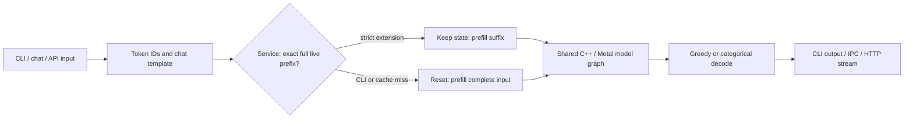

# Inference behavior in engine 1.4.7

This describes the C++/Metal implementation in the optimization `test` branch.
The macOS app and standalone tools use the same parent `cpp/` sources; they do
not contain independently maintained engine copies. Existing SUC1 files and
matching tokenizers remain valid. Compression, tensor payloads, codec allocation,
model sizes, working-set limits and SSD expert budget policy are unchanged.

## Prompt processing and prefill profiles

`cpp/include/suc/prefill.hpp` centralizes conservative chunk planning. Explicit
batched `--chunk N` is honored, including N=64: the historical CLI treated 64 as an
automatic sentinel in some graphs, so old/new comparisons must check the
effective `chunk` in the JSON, not only command-line spelling.

| Graph/profile | Automatic batched policy | Exact/token policy |
|---|---|---|
| Qwen3.8 Flash / dense Qwen3.8, CLI | Up to 1024 rows, capped by prompt length; historical CLI profile retained | Shared exact fallback, explicit chunk wins |
| Qwen3.8 Flash / dense Qwen3.8, app/server | 64 rows; automatic larger Qwen chunks were not promoted | Shared exact fallback, explicit chunk wins |
| DeepSeek / GLM, resident CLI | Up to 4096 rows at context <=8192; 1024 beyond | Automatic exact chunk 16 |
| DeepSeek app/server | Historical 64-row service profile | Automatic exact chunk 16 (64 when streamed) |
| GLM app/server | Historical 512-row service profile | Automatic exact chunk 16 (64 when streamed) |
| Streamed hybrid/MoE CLI graphs | Conservative automatic 64 rows | Automatic exact chunk 64; expert-slot limits still apply |
| Shared token-mode policy | One token at a time | Does not select fast batched arithmetic |

The CLI plans using actual prompt length; app/server retain their historical
service profiles with configured maximum context. Their arena allocations and
timings can therefore differ. Dense Qwen3's existing 64-row path is retained. Graph-specific expert
slot and scratch limits still take precedence. Exact-prefill requests now reach
the Qwen/DeepSeek app graph options as well as the standalone server.

Fast batched prefill is not generally bit-identical to decode-step arithmetic.
Changing chunk sizes can change rounding and continuations. The paired Qwen
hard suite scored 100/120 at chunk 64 and 98/120 at 1024 on the same binary, so
the app/server's conservative profile was kept. These are chunk-profile results,
not a before/after quality gain for the whole release or a reason to silently
change the historical CLI profile.

## Sampling

Greedy decoding still chooses the first maximum. With temperature enabled and
no active top-k/top-p/min-p filtering, the sampler computes the categorical
distribution in O(vocabulary) without sorting the vocabulary. Probability and
index buffers are reused. Filtered sampling retains the sorted path.

The linear path changes cumulative-probability traversal from sorted-logit
order to token-ID order. The intended distribution is unchanged, but the same
seed may produce different sampled text. `SUC_SAMPLING_LEGACY=1` restores the
historical order for A/B reproducibility. Neither a different sampled string
nor a sampler-only microbenchmark establishes a model-quality change or a
universal decode speedup. See the paired real-model measurements.

## Live-prefix reuse and ownership

`LivePrefixEngine` wraps one live engine state per loaded model. It tracks the
token IDs actually fed to inference, including pipelined generation inputs.
Only a strict extension of the entire live prefix is reused. Equal, shorter or
divergent prompts reset and replay. A different chat cannot inherit another
chat's hidden state unless its actual token prefix matches exactly.

The cache is not a disk cache, per-conversation LRU, KV snapshot collection or
partial-prefix rollback. It preserves actual KV, recurrent, convolution and
n-gram states in place. It never treats KV truncation as sufficient to restore
a hybrid model. Cancellation/failure invalidates potentially modified state;
model unload/reload creates a new cache owner. `SUC_PREFIX_CACHE=0` disables
reuse. Requests must still pass the engine's serialization/cancellation guards.

Usage reports full prompt length and `prompt_tokens_details.cached_tokens`;
prefill-work metrics count uncached tokens. A large speedup on a repeated prefix
is reduced time to first token, not faster decode. Warm/cold fast-prefill chunk
boundaries can produce different rounding trajectories; byte-identity evidence
for aligned prefixes is scoped to that protocol, not arbitrary chat histories.
Reload, interleaving and cancellation coverage is recorded separately.

## TCQ kernels and model families

DeepSeek and GLM contexts automatically select the qualified FP32 TCQ prefill
reuse path. It keeps FP32 decoded operands/accumulation while changing register
blocking (RT=2) and retaining 16-row expert tiles instead of splitting them into
8-row halves. It reuses decoded weights; it does not reconstruct the full model
or change stored quantization. Other graph families retain their prior default.
`Context::tcq_reuse()` resolves the per-model choice; `SUC_TCQ_REUSE=0/1`
explicitly overrides it. Pipeline keys include the variant to avoid cache aliasing.

Complete same-reference KL on the selected DeepSeek/GLM files is byte-identical
for all 16x512 validation sequences. The final automatic dispatch is additionally
checked on the shipped binary. Longer-context tests compare memory, final
logits and bounded continuations; they are not full-context BF16 KL measurements.

## Paths deliberately not promoted

| Path | Release behavior | Reason |
|---|---|---|
| N-gram CPU workers | Serial by default; thread-local row scratch; `SUC_NGRAM_THREADS` explicit override | Four-head workers regressed the initial M1 decode comparison; one PLE module has 16 heads, so module-only parallelism was ineffective |
| Two-query attention tiling | Research opt-in `SUC_PREFILL_QUERY_TILE=1` | Synthetic identity and 8k gains do not establish a universal win across shapes/dtypes |
| Half-operand TCQ | Off; `SUC_TCQ_PREFILL_HALF=1` is unqualified research only | Failed the predeclared synthetic KL budget; gate remains a strict expected failure |
| Prompt lookup | Off; explicit restricted greedy Qwen3 experiment | Slower in the measured case; batched verification can change rounding/continuations; not MTP |
| Real MTP | Not implemented in this release | Current SUC1 files omit the heads; separate post-release predictor/verification/state-restoration work is required |

## Evidence, reproducibility and deployment

- [Combined results and release status](RELEASE_1.4.7.md).
- [Reference KL](REFERENCE_KL.md), with identical reference/token hashes and global p95.
- [Rejected/opt-in experiments](M1_RESULTS.md) and [Qwen chunk decision](QWEN_CHUNK_QUALIFICATION.md).
- [Progress and scope](PROGRESS.md), including long-context and session checks.

Version 1.4.7 app/helpers are Universal; the local engine and standalone CLI/server
are Apple Silicon binaries. Intel app operation uses a remote OpenAI-compatible
server. Packages are local ad-hoc/test-branch distributions, not Developer-ID
notarized releases. Build manifests verify the app and standalone tools share
the same C++/Metal input content; documentation-only Git revisions may differ.
No deployed app, main branch, model card publication or Hugging Face weight
upload is changed by generating these local artifacts and documents.

The standalone `suc1-server` defaults to loopback and does not implement the app's
API-key layer. The app's embedded server adds authentication. This distinction
is unchanged by the engine refactoring and must be retained in deployment docs.
